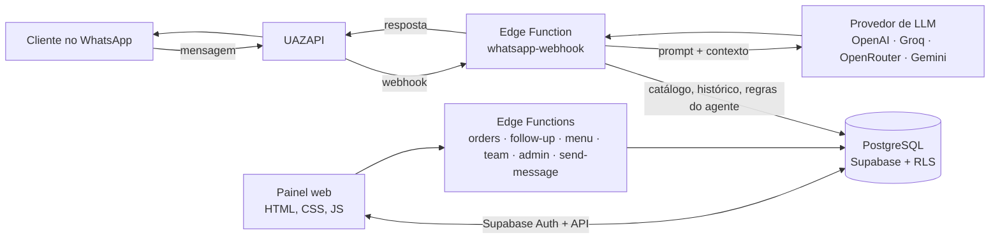

# Lumos CRM

**CRM, ERP e agente de IA no WhatsApp para pequenos negócios.**
SaaS multi-tenant em produção, com 2 clientes ativos e média de mais de 50 atendimentos diários pelo WhatsApp.

🌐 [www.lumos.tec.br](https://www.lumos.tec.br)

---

## O que o Lumos faz

O cliente do negócio manda mensagem no WhatsApp e um agente de IA responde na hora: consulta o catálogo, envia fotos dos produtos, monta orçamentos e pedidos e conduz o lead pelo funil de vendas. Enquanto isso, a equipe acompanha tudo em um painel web, assume a conversa quando quiser e gerencia o restante da operação no mesmo lugar.

O sistema se adapta ao tipo de negócio: lojas em geral, materiais de construção e acabamento, restaurantes e bares, clínicas, salões de beleza e imobiliárias.

## Principais módulos

| Área | Funcionalidades |
| --- | --- |
| Atendimento com IA | Múltiplos agentes, cada um com seu número, prompt e provedor de LLM; envio de fotos do catálogo; pedido pela conversa com confirmação |
| CRM | Leads, clientes, funil kanban configurável por loja, follow-up automático, agendamentos |
| Vendas | Orçamentos para aprovação, pedidos, dados de entrega e acompanhamento pós-venda |
| Restaurante e bar | Mesas e comandas, tela da cozinha, cardápio digital por QR Code, delivery, retirada e reservas |
| ERP | Financeiro, estoque, compras, relatórios e notas fiscais |
| Administração | Painel admin de contas, módulos liberados por cliente, acesso de suporte, equipe com papéis e histórico de ações (auditoria) |

## Arquitetura



**Decisões técnicas relevantes**

- **Isolamento de dados por cliente** com Row Level Security no PostgreSQL: cada loja só enxerga os próprios registros, direto no banco.
- **Provedores de IA intercambiáveis:** cada agente escolhe entre OpenAI, Groq, OpenRouter ou Gemini, com slot pago e gratuito e fallback automático.
- **Proteção da resposta ao cliente:** filtros detectam quando o modelo vaza raciocínio interno ou "enrola" em vez de responder, e a formatação Markdown é convertida para o padrão do WhatsApp.
- **Frontend sem build:** páginas estáticas com módulos ES, publicadas no GitHub Pages com domínio próprio.

## Stack

`TypeScript` `Deno` `Supabase` `PostgreSQL` `JavaScript` `HTML/CSS` `UAZAPI` `OpenAI` `Gemini` `Groq` `OpenRouter` `GitHub Pages`

## Estrutura

```
├── *.html                 páginas do painel (dashboard, kanban, leads, cozinha, financeiro...)
├── css/styles.css         design system com tema claro e escuro
├── js/                    lógica do frontend por módulo
├── supabase/functions/    7 Edge Functions em TypeScript
└── docs/INSTALACAO.md     passo a passo de configuração e schema SQL completo
```

## Como rodar

O guia completo de configuração (Supabase, tabelas, políticas de segurança, Edge Functions e integração com WhatsApp) está em [docs/INSTALACAO.md](docs/INSTALACAO.md).

---

Desenvolvido por [Gabriel Soares](https://www.linkedin.com/in/gabriel-s-3813a6367).
